  

  

  
  
  
  

 

## About Me

Developer and designer, building clean, functional interfaces at the intersection of code and design.

- 🎓 **Bachelor's student** in **Computer Science / Informatics**
- 🌱 Learning **Full Stack Development**
- 🔭 Building my **portfolio projects**
- 🎨 **Designer & editor** on the side
- 🚀 Goal: **bridging design and development**

 

## Tech Stack

  
  
  
  
  
  

